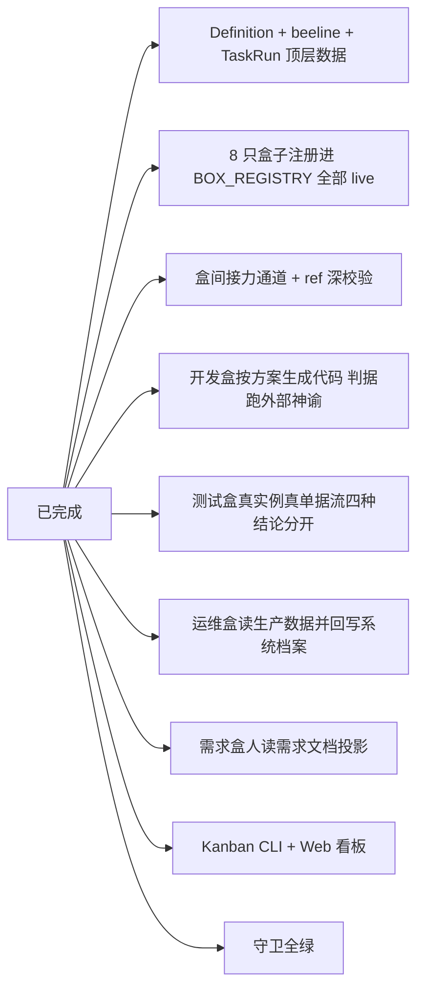

# beeOS

> Business Fulfillment Operating System — 业务履约操作系统

beeOS 是一个面向业务的履约操作系统：把一次业务履约（business fulfillment）
建模为可验证的产物，而不是一段胶水脚本。

## 三句话架构宣言

- **beeOS**：提供让业务履约可被定义、可被运行、可被验收的基础设施
- **beeBox**：单一业务履约盒子的完整定义 + 实现 + 验收契约
- **Business Fulfillment fulfills under explicit contract and policy,
  producing verifiable result**：履约按明确合同与政策发生，
  产出可被验收的业务结果

## 仓库结构

```mermaid
flowchart TB
    Repo[beeOS repo]
    Repo --> Docs[docs/ 规格与设计稿]
    Repo --> Core[core/ 内核数据结构]
    Repo --> Boxes[boxes/ 业务履约盒子]
    Repo --> Runtime[runtime/ 执行内核]
    Repo --> Kanban[kanban/ 运行看板]
    Repo --> Scripts[scripts/ 部署与校验]
    Repo --> Tests[tests/ 守卫]

    Boxes --> B1[wms_requirement 需求捕获]
    Boxes --> B2[wms_design 仓储建模]
    Boxes --> B3[wms_development 代码生成]
    Boxes --> B4[wms_testing 场景验证]
    Boxes --> B5[wms_ops 运维核对]
    Boxes --> B6[wms_analysis 效果分析]
    Boxes --> B7[wms_system 系统档案]
    Boxes --> B8[receipt 小票识别]

    Runtime --> R1[executor + TaskRun + Acceptance]
    Runtime --> R2[contract 投料闸 + handoff 盒间接力]
    Runtime --> R3[runner 分派机制 + llm 客户端]
    Kanban --> K1[CLI 看板 + Web 看板]
    Kanban --> K2[trigger 投料口 + BOX_REGISTRY]
```



## 布局说明

- **`docs/`** — 规格与设计稿（9 份）
  - `beebox-design.md` — 主设计稿（架构宣言 / 核心契约 / 执行语义 / 实现设计）
  - `beebox-definition-schema.md` — beeBox Definition 数据形状
  - `beebox-beeline-schema.md` — beeline / Operation 数据形状
  - `beebox-runtime-design.md` — Runtime 设计
  - `beebox-runtime-schema.md` — Runtime 数据形状
  - `beeline.md` — beeline 是什么、为什么住在盒子里
  - `beeos-gtm.md` — 商业定位 / Catalog / Certification / 飞轮
  - `wms-closure-plan.md` — WMS 域「一个需求走完全链」的补齐计划与实测记录
  - `examples/order-exception-box.md` — 订单异常履约盒完整示例

- **`core/`** — 基础设施内核（只有数据结构，不含业务语义）
  - `models.py` — Definition / Schema / Field / Task / Result / Acceptance /
    Exception / Queen / Metrics 顶层数据结构（pydantic）
  - `beeline_models.py` — beeline / Operation / NextRef / Idempotency / Bee /
    ExternalSystem（含 DAG 校验）
  - `metrics.py` — 指标计算契约

- **`boxes/`** — 业务履约盒子（产品层）。**8 只，全部已注册**
  - 每只盒子：`__init__.py` / `schemas.py` / `definition.py` / `runner.py`
    / `measure.py` / `beeline.py` / `README.md`

  **beeline 住在盒子里**（`boxes/<box>/beeline.py`），因为它跟盒子是 1:1
  且不可分割：它引用的 schema id 全部来自本盒的 `schemas.py`，每个 op 的
  handler 都在本盒的 `runner.py` 里。顶层一个独立的 beeline 目录只会让人
  以为存在一种可复用的跨盒路线，实际上一条都没有。
  路线细节见 [`docs/beeline.md`](docs/beeline.md)。

  | 目录 | box_id | 域 | 判据 | 例外 | 状态 |
  |---|---|---|---|---|---|
  | [`wms_requirement/`](boxes/wms_requirement/README.md) | `wms_requirement_box` | WMS | 4 | 2 | live |
  | [`wms_design/`](boxes/wms_design/README.md) | `wms_design_box` | WMS | 8 | 4 | live |
  | [`wms_development/`](boxes/wms_development/README.md) | `wms_development_box` | WMS | 4 | 2 | live |
  | [`wms_testing/`](boxes/wms_testing/README.md) | `wms_testing_box` | WMS | 6 | 2 | live |
  | [`wms_ops/`](boxes/wms_ops/README.md) | `wms_ops_box` | WMS | 5 | 2 | live |
  | [`wms_analysis/`](boxes/wms_analysis/README.md) | `wms_analysis_box` | WMS | 4 | 2 | live |
  | [`wms_system/`](boxes/wms_system/README.md) | `wms_system_box` | WMS | 5 | 3 | live |
  | [`receipt/`](boxes/receipt/README.md) | `receipt_capture_box` | 未归域 | 6 | 2 | live |

- **`runtime/`** — 执行运行时（**不含任何业务知识**）
  - `models.py` — TaskRun durable object + 9 状态机 + Acceptance 4 状态
  - `executor.py` — BeelineExecutor（顺序 / 分支 + when 评估）
  - `runner.py` — HandlerRunner：按 `op.type` 找到该跑的 handler（纯机制）
  - `contract.py` — 投料结构契约闸（履约前第一道闸）
  - `handoff.py` — 盒间接力：把上游产出接到下游投料的 `ref:` 字段上
  - `acceptance.py` — Acceptance 评估器（4 状态转移）
  - `queen.py` — Queen escalation hook
  - `store.py` — TaskRunStore（JSONL 持久化 + 查询）
  - `llm.py` — LLM 客户端（只管传输与解析，业务提示词由调用方给）

- **`kanban/`** — 运行面板（CLI + Web + task 投料口）
  - `cli.py` — CLI 看板（`python -m kanban.cli`）
  - `web.py` — Web 看板（`python -m kanban.web`，HTTP server + HTML + JS）
  - `trigger.py` — 投料口（`BOX_REGISTRY` + `trigger_task`：校验 → 执行 → 验收 → 落盘）

- **`scripts/`** — 部署与校验
  - `deploy.sh` — 部署上线（同步 → 重启服务 → 线上自检）
  - `run_chain.py` — 端到端串跑多只盒子
  - `verify_mermaid.py` — 文档里的 mermaid 块渲染校验
  - `standardization_audit.py` — 标准化审计

- **`tests/`** — 守卫（千条量级，以守卫为主）
  - 通用契约：`test_definition.py` / `test_beeline.py` / `test_runtime.py` /
    `test_box_standard.py` / `test_box_refs.py` / `test_box_naming.py` /
    `test_layering.py` / `test_intake_contract.py` / `test_metrics.py`
  - 看板：`test_kanban.py` / `test_web_kanban.py`
  - 盒子：`test_receipt_box.py` / `test_receipt_corpus.py` /
    `test_wms_requirement_box.py` / `test_wms_requirement_extraction.py` /
    `test_requirement_document.py` / `test_wms_design_box.py` /
    `test_wms_design_binder.py` / `test_wms_design_expectations.py` /
    `test_wms_development_box.py` / `test_wms_testing_box.py` /
    `test_wms_ops_box.py` / `test_wms_analysis_box.py` / `test_wms_system_box.py`
  - 其他：`test_llm_structurer.py` / `test_stub_isolation.py` / `test_subject_ref.py`
  - 文档：`test_docs_match_code.py`（本文档引用的每个路径都真实存在）

## 当前状态



> 测试规模：**千条量级**。真实条数以 `.venv/bin/python -m pytest tests/ -q` 报的为准——
> 本文不写死数字（写死的数字必然过期，仓库里有一条守卫专门盯着这件事）。

WMS 域 8 只盒子已串成一条可运行的链：

```
需求捕获 → 仓储建模 → 代码生成 → 场景验证 → 运维核对 → 效果分析
   ↑                                          │
   └────────  下一轮需求种子（效果分析反馈）────┘
```

上面每一跳**同时汇进系统档案盒**（`wms_system_box`）——它是 WMS 域的汇点，
过程产物留在各自盒子里，档案只沉淀「这套系统此刻是什么样」。

未完成的部分见 `docs/wms-closure-plan.md` 的「诚实边界」一节：
四个 WMS 指标（拣货准确率等）在 WMS 系统里**还没实现**，
线上 WMS 还没有业务流量，生产实测值暂时采不到。

## 开发

```bash
# Python 3.11+
.venv/bin/python -m pytest tests/ -q

# 加载一只盒子
.venv/bin/python -c "from boxes.wms_design import get_definition; d = get_definition(); print(d.id, d.version)"

# 端到端冒烟（建模盒）
.venv/bin/python -c "
from boxes.wms_design import get_definition, get_beeline
from boxes.wms_design.runner import RUNNER
from runtime import create_task_run, BeelineExecutor, evaluate_acceptance
box = get_definition(); beeline = get_beeline()
input_data = {'set_id': 'r1', 'business_goal': 'test', 'requirements': [{'requirement_id': 'req_obj_1', 'description': 'x', 'requirement_type': 'object', 'priority': 'must_have'}]}
tr = create_task_run('pm', 'handle_modeling_request', box.result.result_schema, f'{box.id}@v{box.version}', beeline.id, beeline.version, 'rt', 'in')
tr = BeelineExecutor(RUNNER).execute(tr, beeline, input_data)
print('wms_design:', tr.status.value, tr.result)
"

# 跑 Kanban CLI 看板
.venv/bin/python -m kanban.cli

# 跑 Kanban Web 看板（浏览器打开 http://localhost:8765）
.venv/bin/python -m kanban.web
```
