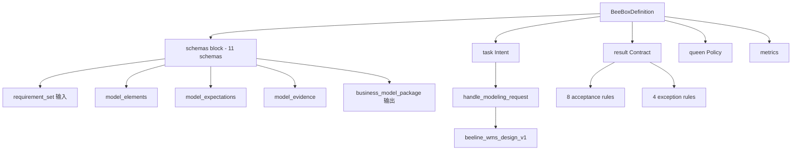

# WMS 仓储建模履约盒（wms_design_box）

> 按结构化仓储需求产出可机械验证的 WMS 模型包——实体、约束、指标，外加可判定的预期。

## 业务定位

链条的第二环。它回答的是：**这条需求在 WMS 领域里到底是什么**。

产出分三块：

- **模型元素**——WMS 实体（SKU / 货主 / 库位 / 库存 / 批次 / 波次 / 盘点）、
  WMS 约束（库位占用唯一 / 先进先出 / 安全库存 / 波次合并…）、WMS 运营指标
- **可判定的预期**（`expectations`）——每条需求落到哪个 WMS 概念上，
  概念的标准表述是什么，业务原话的逐字证据在哪
- **验证证据**——覆盖 / 一致性 / 引用 / 结构 / 指标五类

「预期」这一层是设计盒的产出，不是需求盒的：需求盒手里只有业务原话，
做不出**可判定**的预期；而「怎么测」是测试盒的知识，不该由设计盒替它决定。

## 判据与例外

**8 条判据**，全部机械可判，没有「模型好不好」这种主观项：

| # | 判据 | 口径 | op | value |
|---|---|---|---|---|
| 1 | `requirement_coverage` | 每条需求都被模型元素认领 | gte | 100 |
| 2 | `rule_consistency` | 规则无矛盾（WMS 约束互斥表）| eq | true |
| 3 | `reference_integrity` | 引用全部解析成功 | eq | true |
| 4 | `structural_compliance` | 结构符合建模标准 | eq | true |
| 5 | `metrics_defined` | 每个指标有 target 值 | eq | true |
| 6 | `wms_binding` | 认得出这是 WMS 模型 | eq | true |
| 7 | `wms_rule_binding` | 约束也认得出是 WMS 的 | eq | true |
| 8 | `expectation_completeness` | 认出的每个 WMS 概念都变成一条预期 | eq | true |

后两条是 **WMS 专属的**：少了它们，一个纯通用的「当库存 > 0 时…」照样前 5 条全绿，
而盒子挂着 WMS 的招牌。

**4 条例外**：需求数超限 → 升级；`rule_consistency` 为假 → 回滚；
没有业务负责人 → 不交付；有需求绑不上 WMS 概念 → 升级。

## 已知盲区（如实声明）

WMS 绑定是**关键词机械匹配**，认不出同义改写（「拣货」/「按订单取货」/「order picking」
认作三个词）。认不出的需求会被 `wms_binding` 判红并点名——
**宁可红，不要假装绑上了**。

## beeline 7 ops

```
parse_requirements → classify_requirements → generate_model_elements →
verify_coverage → check_consistency → generate_evidence → package_model
```

全部 ops 用 `idempotency.mode=required, key=set_id`，重复建模产出同模型。

## 数据形状



## 文件

- `__init__.py` — 入口（`get_definition`）
- `schemas.py` — 11 个 schema
- `definition.py` — BeeBoxDefinition 实例
- `domain.py` — WMS 概念词表（实体 / 约束 / 指标 + 例词 + 代码落点）
- `binder.py` — 需求 ↔ WMS 概念绑定
- `runner.py` — 7 个 op 的 handler
- `measure.py` — 指标采集
- `beeline.py` — beeline_wms_design_v1

## 加载

```python
from boxes.wms_design import get_definition, get_beeline
from runtime import create_task_run, BeelineExecutor, evaluate_acceptance

box = get_definition()
beeline = get_beeline()

input_data = {
    "set_id": "req_set_001",
    "business_goal": "建模订单退款流程",
    "requirements": [
        {"requirement_id": "req_obj_1", "description": "订单实体", "requirement_type": "object", "priority": "must_have"},
    ],
}

task_run = create_task_run(...)
task_run = BeelineExecutor(RUNNER).execute(task_run, beeline, input_data)
eval_result = evaluate_acceptance(task_run, box.result)
# → ACCEPTED / REJECTED / COMPENSATING_ACCEPTANCE
```
