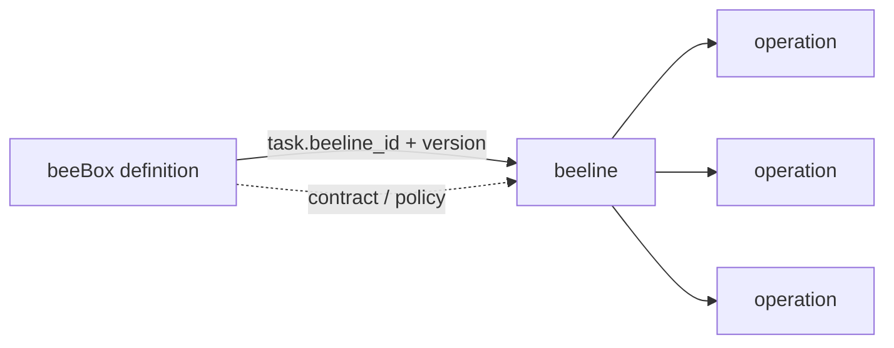
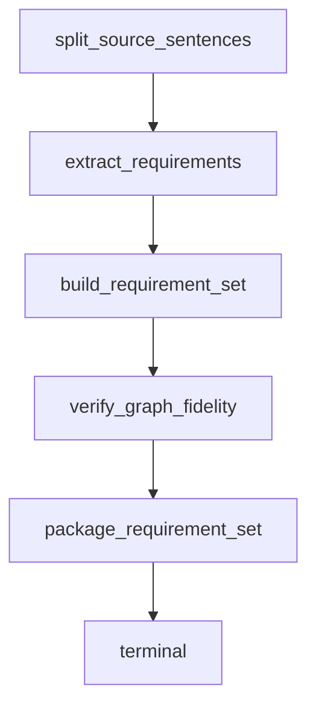

# beeline - 履约作业路线（procedure 实现）

> beeline 是 1 类任务的标准作业路线，本质是 1 张有向图——节点是 operation，
> `next` 字段是节点之间的有向边（支持顺序 / 并发 / 分支）。

## 与 boxes/ 的关系

- **boxes/** — 业务履约盒子（contract + intent + queen policy + 作业路线）

beeline **住在盒子里**：`boxes/<box>/beeline.py`。

理由不是「整齐」，是事实：beeline 与盒子是 **1:1 且不可分割** 的——
它引用的 schema id 全部来自本盒的 `schemas.py`，每个 op 的 handler
都在本盒的 `runner.py` 里。9 只盒子 9 条 beeline，没有一条被两只盒子
共享，没有一条引用过别的盒子的 schema。

放在仓库顶层一个单独的目录，只会让人以为存在一种「可复用的跨盒作业路线」，
而实际上一条都没有。

**但「不归 definition 管」这一点仍然成立**：definition 不内嵌路线，
它通过 `task[].beeline_id + beeline_version` **引用**它。
位置和引用方式是两件事。

将来如果真出现跨盒流程（一条发版路线串起 dev → test → ops），
那应该另立一层（比如 `flows/`），而不是把顶层那个独立目录留着等它长大——
而且跨盒 beeline 需要先有模型支持：`Operation.input_from` 现在只接受
`"external"` 或同一条 beeline 内的 op_id。



## 布局（节选两例）

```
boxes/
  wms_requirement/
    beeline.py               # 需求盒的作业路线（split → extract → build → verify → package）
    definition.py
    runner.py
    schemas.py
  wms_system/
    beeline.py               # WMS System Box 的作业路线（system_intake → probe → packager）
    definition.py
    runner.py
    schemas.py
    baseline/                # 盒子自带的基线资产
```

其余 6 只盒子同构：每只一个 `beeline.py`，目录清单见仓库根 README 的盒子表。

## 举例：beeline_wms_requirement_v1 (v1)

需求盒的作业路线——把一段自然语言业务表述变成可机械验证的需求集：



5 个 operation / 1 个入口 / 1 个终态 / 线性链。

> **当前已注册的 8 只盒子，beeline 全是线性链。**
> runtime 支持分支（`next` 带 `when` 条件）与 fan-in，
> 但产品侧暂时没有用到——「声明了分支能力」和「产品真有分支」是两件事，
> 这里只说前者。

## 幂等性策略

| operation | mode | key | 原因 |
|---|---|---|---|
| `split_source_sentences` | required | set_id | 同一批需求重复切句必须同结果 |
| `extract_requirements` | required | set_id | 重复抽取不产生第二份需求 |
| `build_requirement_set` | required | set_id | 同一需求集只有一份结构 |
| `verify_graph_fidelity` | required | set_id | 忠实度校验结果稳定 |
| `package_requirement_set` | required | set_id | 重复打包产出同一份需求集 |

**`forbidden` 的用法**：不可重复的动作（发通知、扣库存）声明成
`mode=forbidden`，而不是 `required`——两者语义不同：
`required` 是「重复执行要幂等」，`forbidden` 是「根本不该执行第二次」。

## 加载

```python
from boxes.wms_requirement import get_beeline

b = get_beeline()                                # beeline_wms_requirement_v1 v1
b.get_operation("extract_requirements")          # 查 operation
b.get_start_operations()                         # 入口 ops
```

## 入口校验

`Beeline` model_validator 强制：
- `op_id` 唯一
- `next.op_id` 引用必须真实存在
- `input_from` 必须 `external` 或真实 op_id
- 每 op 至少 1 个 bee / external_system
- 有向无环（DAG）——拓扑排序校验

完整数据形状参考 [`docs/beebox-beeline-schema.md`](../docs/beebox-beeline-schema.md)。