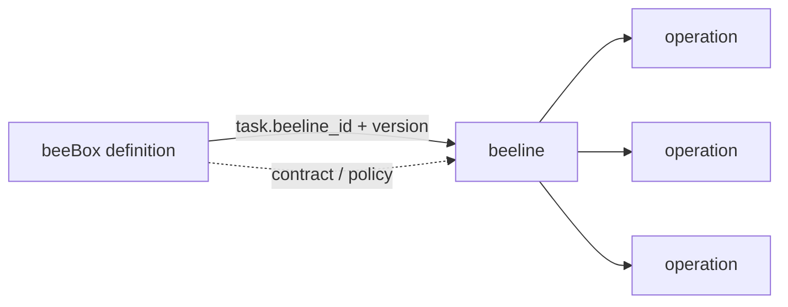
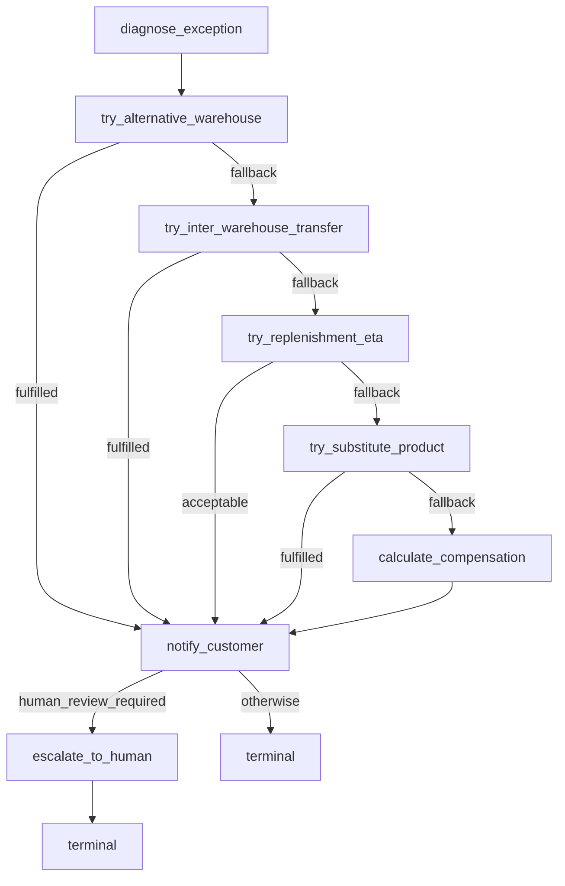

# beelines - 履约作业路线（procedure 实现）

> beeline 是 1 类任务的标准作业路线，本质是 1 张有向图——节点是 operation，
> `next` 字段是节点之间的有向边（支持顺序 / 并发 / 分支）。

## 与 boxes/ 的关系

- **boxes/** — 业务履约盒子（contract + intent + queen policy + 作业路线）

beeline **住在盒子里**：`boxes/<box>/beeline.py`。

理由不是「整齐」，是事实：beeline 与盒子是 **1:1 且不可分割** 的——
它引用的 schema id 全部来自本盒的 `schemas.py`，每个 op 的 handler
都在本盒的 `runner.py` 里。9 只盒子 9 条 beeline，没有一条被两只盒子
共享，没有一条引用过别的盒子的 schema。

放在仓库顶层一个单独的目录，只会让人以为存在一种「可复用的跨盒作业路线」，
而实际上一条都没有。

**但「不归 definition 管」这一点仍然成立**：definition 不内嵌路线，
它通过 `task[].beeline_id + beeline_version` **引用**它。
位置和引用方式是两件事。

将来如果真出现跨盒流程（一条发版路线串起 dev → test → ops），
那应该另立一层（比如 `flows/`），不是把 `beelines/` 留在原地等它长大——
而且跨盒 beeline 需要先有模型支持：`Operation.input_from` 现在只接受
`"external"` 或同一条 beeline 内的 op_id。



## 布局

```
boxes/
  inventory_shortage/
    beeline.py               # 库存不足订单履约作业路线（v3 ver12）
    definition.py
    runner.py
    schemas.py
  wms_system/
    beeline.py               # WMS System Box 的作业路线（system_intake → probe → packager）
    definition.py
    runner.py
    schemas.py
    baseline/                # 盒子自带的基线资产
```

## 第一只 beeline：beeline_inventory_shortage_v3 (v12)

业务流——按 queen `inventory_shortage_priority` 优先级链：



8 个 operation / 4 个 try_* 分支 / 1 个 fan-in 汇聚点 / 1 个终态。

## 幂等性策略

| operation | mode | key | 原因 |
|---|---|---|---|
| `diagnose_exception` | required | order_id | 重复诊断必须同结果 |
| `try_alternative_warehouse` | required | order_id | 不重复扣减库存 |
| `try_inter_warehouse_transfer` | required | order_id | 不重复发起调拨 |
| `try_replenishment_eta` | required | order_id | 不重复查询 ETA |
| `try_substitute_product` | required | order_id | 不重复锁替代品 |
| `calculate_compensation` | required | order_id | 不重复计算补偿 |
| `notify_customer` | **forbidden** | — | 不重复发通知 |
| `escalate_to_human` | required | order_id | 不重复升级 |

## 加载

```python
from boxes.inventory_shortage import get_beeline

b = get_beeline()                                # beeline_inventory_shortage_v3 v12
b.get_operation("try_alternative_warehouse")     # 查 operation
b.get_start_operations()                         # 入口 ops
```

## 入口校验

`Beeline` model_validator 强制：
- `op_id` 唯一
- `next.op_id` 引用必须真实存在
- `input_from` 必须 `external` 或真实 op_id
- 每 op 至少 1 个 bee / external_system
- 有向无环（DAG）——拓扑排序校验

完整数据形状参考 [`docs/beebox-beeline-schema.md`](../docs/beebox-beeline-schema.md)。