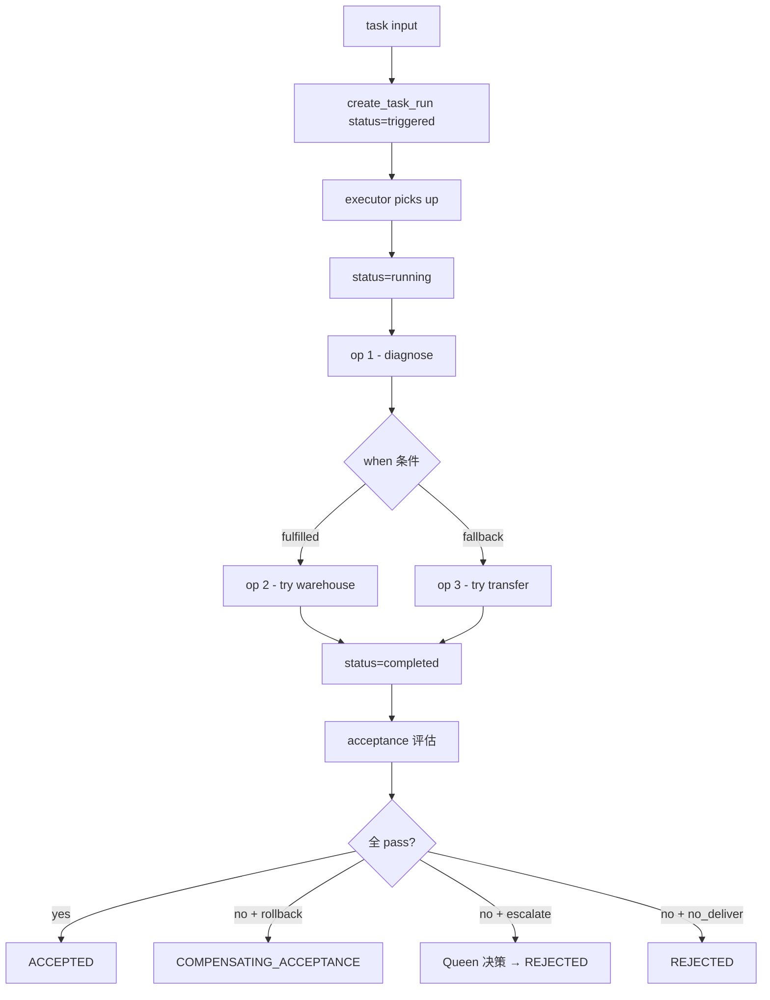

# runtime - 进程内 executor + TaskRun + Acceptance

> 按 [beebox-design.md §3.4] 实现的业务履约运行时。
> **业务语义是真的，基础设施可以是假的**——PoC 2 在进程内跑通完整 task run 闭环。

## 模块

```
runtime/
  __init__.py            # 统一导出
  models.py              # TaskRun durable object + 9 状态机 + Acceptance 4 状态
  executor.py            # BeelineExecutor（顺序 / 分支推进 + when 评估）
  runner.py              # HandlerRunner（按 op.type 找 handler，纯机制）
  contract.py            # 投料结构契约闸（履约前第一道闸）
  handoff.py             # 盒间接力：上游产出 → 下游 ref 字段
  acceptance.py          # Acceptance 评估器（4 状态转移）
  queen.py               # Queen escalation hook
  store.py               # TaskRunStore（JSONL 持久化 + 查询）
  llm.py                 # LLM 客户端（只管传输与解析）
```

**这个包不含任何业务知识。** handler 在各盒子的 `runner.py` 里，
runtime 只负责「按 `op.type` 找到该跑的 handler 并执行」。

## 流程



## TaskRun 9 状态机

| 状态 | PoC 2 | 含义 |
|---|---|---|
| `triggered` | ✅ | task run 创建，等待进入执行 |
| `running` | ✅ | 正在按 beeline 执行 operation |
| `RETRYING` | ⏳ 下一轮 | op 失败重试中 |
| `PARTIALLY_COMPLETED` | ⏳ 下一轮 | 部分 op 完成 |
| `WAITING_EXTERNAL` | ⏳ 下一轮 | 等待外部响应 |
| `COMPENSATING` | ⏳ 下一轮 | 触发补偿 |
| `REJECTED` | ⏳ 下一轮 | 显式拒绝 |
| `COMPLETED` | ✅ | 正常完成（beeline 跑完） |
| `FAILED` | ✅ | 失败（验收不通过 / op 失败） |

## Acceptance 4 状态机（独立阶段）

| 状态 | 含义 |
|---|---|
| `AWAITING_ACCEPTANCE` | task run COMPLETED 后进入，等验收判定 |
| `ACCEPTED` | 验收通过 → Business Fulfillment 成功 |
| `REJECTED` | 验收不通过 → Business Fulfillment 失败 |
| `COMPENSATING_ACCEPTANCE` | 触发补偿（执行反向 op 后回 AWAITING）|

## 端到端冒烟

```python
from boxes.inventory_shortage import get_definition, get_beeline
from runtime import (
    create_task_run, BeelineExecutor, evaluate_acceptance,
    default_queen_escalation_handler,
)

box = get_definition()
beeline = get_beeline()

# 1. 创建 task run
task_run = create_task_run(
    originator="orders.api",
    intent="handle_order_exception",
    contract_ref=box.result.result_schema,
    release_id=f"{box.id}@v{box.version}",
    beeline_id=beeline.id, beeline_version=beeline.version,
    runtime_id="runtime_dev", instance_id="instance_local",
)

# 2. 执行 beeline
executor = BeelineExecutor()
task_run = executor.execute(task_run, beeline, input_data)
# → status: triggered → running → completed

# 3. 跑 acceptance
eval_result = evaluate_acceptance(
    task_run, box.result,
    queen_decision_fn=lambda tr, failed: default_queen_escalation_handler(
        tr, failed, box.queen.rules.model_dump()
    ),
)
# → status: ACCEPTED / REJECTED / COMPENSATING_ACCEPTANCE
```

## op → handler 的映射在哪

**不在 runtime 里**。runtime 的 `runner.py` 只做「按 `op.type` 找 handler」这一件事，
handler 由各盒子自己提供（`boxes/<box>/runner.py`）。

例：订单异常盒的 8 个 op（`diagnose_exception` / `try_alternative_warehouse` /
`try_inter_warehouse_transfer` / `try_replenishment_eta` / `try_substitute_product` /
`calculate_compensation` / `notify_customer` / `escalate_to_human`）
全部实现在 `boxes/inventory_shortage/runner.py`。

这条边界是硬边界：**runtime 里出现任何 WMS 词、票据词、需求词，就是越界了**
（`tests/test_layering.py` 盯着）。

## Queen 自治边界

PoC 2 实现 escalation decision hook：
- 触发场景：acceptance 失败 + exception.action=escalate
- 决策依据：`queen.rules.exception_handling.escalation_rules`
- 默认返回 `auto_resolve` 或 `queen.<action>`

Queen 不可改：contract / acceptance / release / policy（bounded autonomy）。

## PoC 2 时期暴露的真实问题（历史记录）

- 早期 mock runner 没填满所有 result 字段，导致 acceptance 大部分 rule fail
- acceptance rule 设计需要 executor 辅助填字段（如 `order_state_consistent`、`evidence_complete`）

这两条都已在「handler 归盒子、runtime 只做分派」的边界下解决：
字段填不满是盒子的责任，不是 runtime 的。